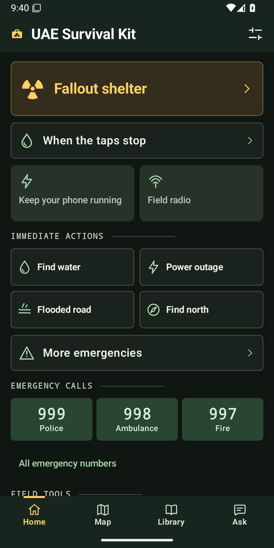
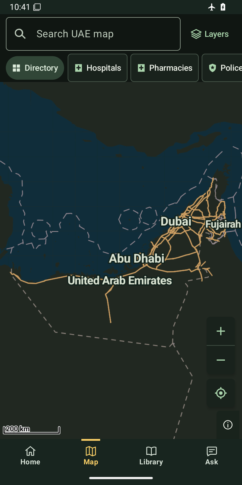
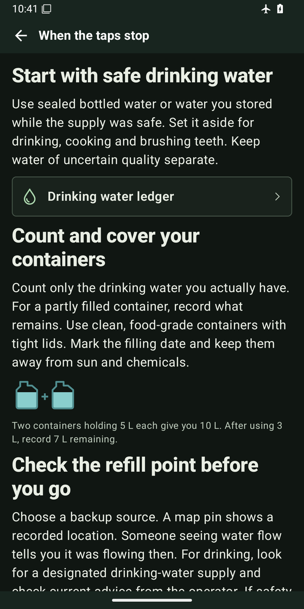

<h1> UAE Survival Kit</h1>

**[Download the Android APK · 1.24 beta 1](https://github.com/megaacheyounes/uae-survival-kit/releases/download/1.24-beta.1/UAE-Survival-Kit-1.24-beta.1.apk)** · [Release notes and checksums](https://github.com/megaacheyounes/uae-survival-kit/releases/tag/1.24-beta.1)

A free offline preparedness app for all seven emirates. Open the downloaded APK on an ARM64 phone or tablet running Android 11 or later.

| Home | Offline UAE map | When the taps stop |
| :---: | :---: | :---: |
|  |  |  |

Map data © [OpenStreetMap contributors](https://www.openstreetmap.org/copyright).

## What works offline

- **Guides and emergency contacts.** Read illustrated steps for heat, floods, blackouts and shelter. The water-outage guide includes a drinking-water ledger with undo and a printable card in English or Arabic.
- **UAE street map.** Open Map once to unpack the included map, even in airplane mode. Find nearby hospitals, pharmacies, fuel and water points. A mapped tap still needs a local check for safe drinking water.
- **Library and Ask.** Import your own PDFs and videos, bookmark a page or resume playback. Ask a question in English and jump to the passage behind the answer.
- **Nearby radio.** Exchange public messages over Bluetooth, or pair two phones on local Wi-Fi or a hotspot for private chat and push-to-talk.

Satellite imagery and on-device AI are optional. Download or import them ahead of time if you want to use them offline.

[Build from source](docs/BUILD.md) · [Apache 2.0 license for the original code](LICENSE). Third-party content retains its own licenses.
